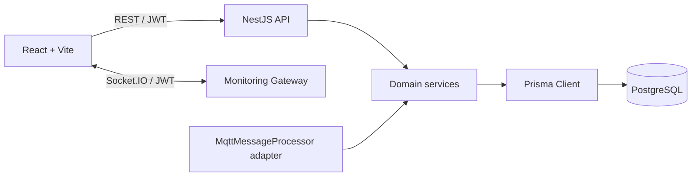

# Architecture Overview

The frontend and backend are independent TypeScript applications. The browser calls the NestJS REST API under `/api/v1` using a short-lived access token. Prisma is the only persistence boundary for backend application data, backed by PostgreSQL.

Telemetry and event ingestion are transport-independent services. Database writes complete before the gateway broadcasts the corresponding update. The MQTT processor validates payloads and delegates to those services; broker connection lifecycle and subscriptions are intentionally not started in this phase.

The ESP32 remains the authority for local electrical protection. The application stores reported states and configuration delivery acknowledgements; server-side telemetry does not issue contactor commands or convert a trip/recovery state to NORMAL.

Seeded demonstration measurements carry `SIMULATED` source and are charted separately from `DEVICE` data. A seeded device stays OFFLINE with UNKNOWN protection state until actual connectivity/status is reported.
